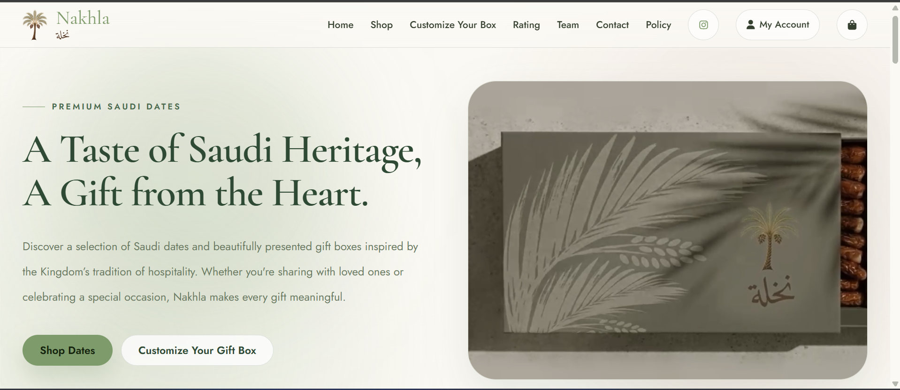
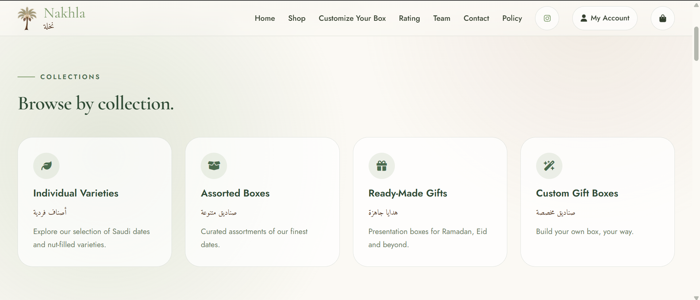
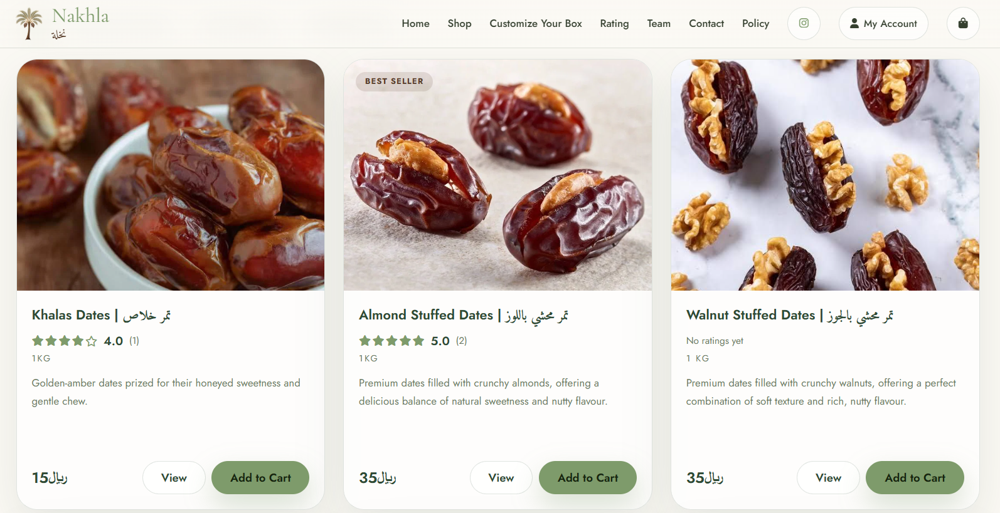
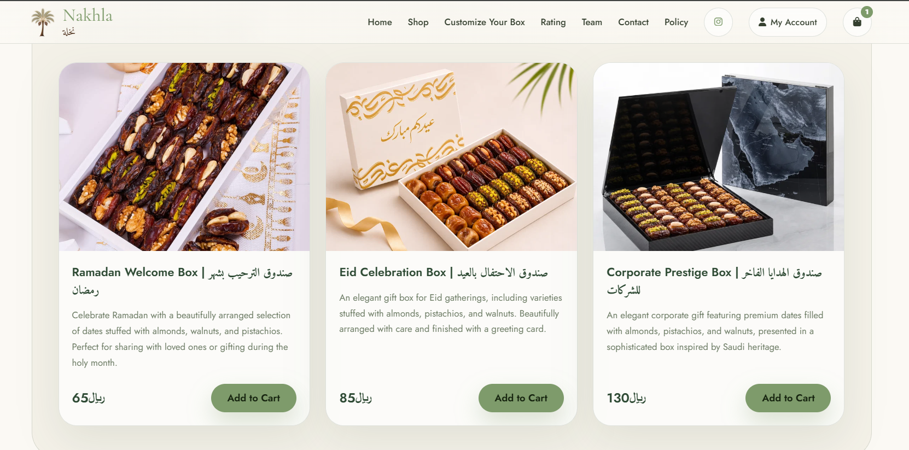
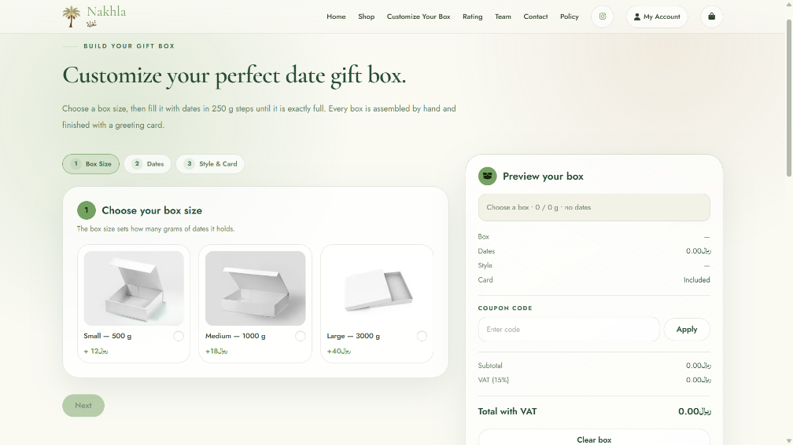
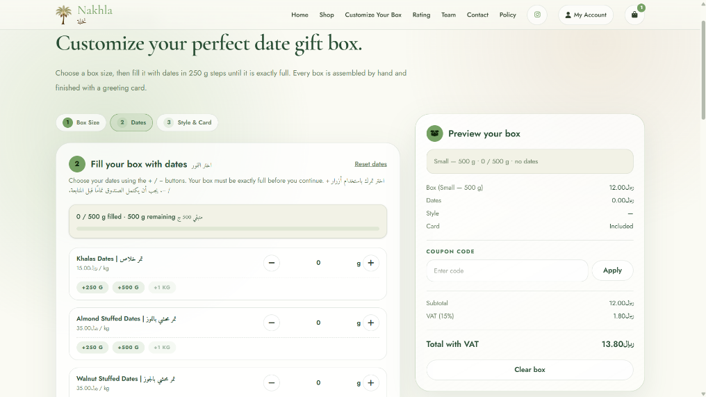
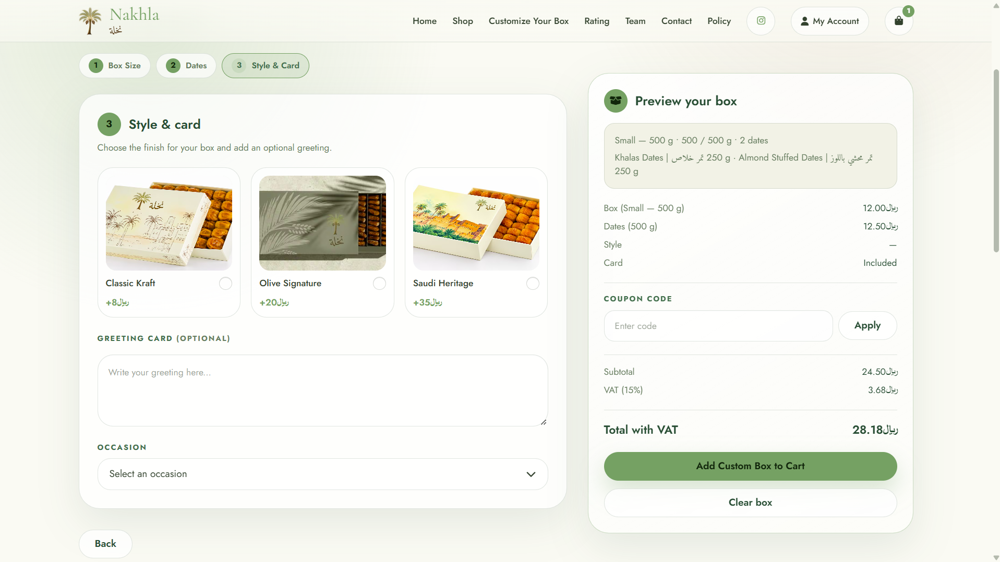
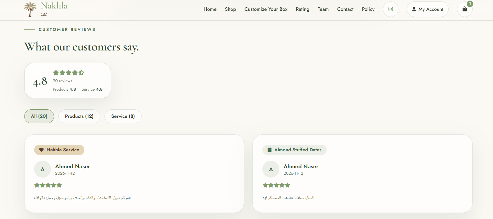
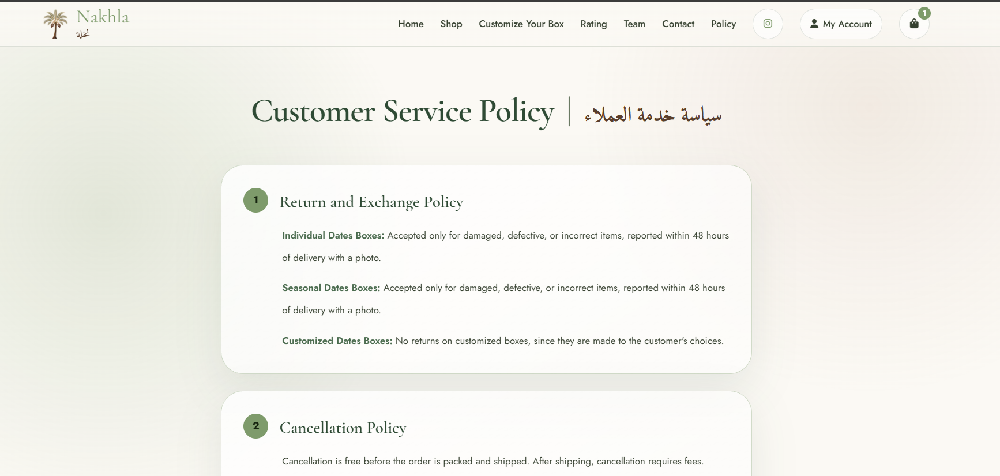

# 🌴 Nakhla | نخلة

### Saudi Dates & Personalized Gift Boxes

*A taste of Saudi heritage, a gift from the heart.*

 

-B7C4A1?style=flat-square)

 

---

## 📖 Contents

[About](#-about-the-project) · [Features](#-features) · [Business overview](#-business-overview) · [Operations](#%EF%B8%8F-operations-and-technology) · [Screenshots](#-website-screenshots) · [Project information](#-project-information) · [Repository contents](#-repository-contents)

---

## 🌟 About the project

Nakhla is an e-commerce course project focused on Saudi dates and personalized gifting. Customers can explore date products, choose ready-made gift boxes, or create a custom box by selecting date varieties, quantities, box size, packaging, and a personal greeting-card message.

## ✨ Features

| | Feature | Details |
|---|---|---|
| 🌴 | **Date varieties** | Nine Saudi date varieties, each with image, description, and price |
| 🎁 | **Ready-made gift boxes** | Five gift-box options for Ramadan, Eid, and corporate gifting |
| 🛠️ | **Custom gift boxes** | Three sizes (500 g, 1 kg, 3 kg) and three packaging styles |
| 💌 | **Greeting cards** | A personalized message added to every box |
| 🛒 | **Shopping experience** | Product catalog, product details, cart, checkout interface |
| ⭐ | **Customer care** | Ratings, contact form, and policy pages |

## 💼 Business overview

Nakhla aims to make buying Saudi dates online convenient and turn them into meaningful gifts for Ramadan, Eid, graduations, and family visits. Its value proposition combines a focused selection of Saudi dates with a flexible gift-box customization experience.

### 📊 Business analysis

- **Target customers:** individuals and families, gifting customers, customers who value Saudi products, and corporate buyers.
- **Customer needs:** convenient product browsing, flexible gifting choices, clear pricing, product details, delivery information, and customer policies.
- **Competitive positioning:** customization of date varieties, quantities, packaging, occasion, and greeting-card message.
- **Business model:** B2C online retail.
- **Revenue model:** sales of individual date products and ready-made or customized gift boxes.

📄 For the full analysis, see [Project Overview & Business Analysis](docs/PROJECT-OVERVIEW.md).

## ⚙️ Operations and technology

| | |
|---|---|
| 🖥️ **Website platform** | SITE123, provided through a Software as a Service (SaaS) model |
| 💳 **Payment gateway** | Moyasar, as described in the business plan |
| 🚚 **Fulfillment** | Hatik Express for storage, packing, and delivery; Aramex and SMSA are additional delivery providers |
| 📣 **Marketing** | Instagram content, seasonal promotions, coupon campaigns, and promotional partnerships |

> **ℹ️ Project scope note:** Nakhla is a university course project built on SITE123. The presence of checkout or payment options on the website does not by itself confirm that live commercial transactions are fully operational. Refer to the current website configuration for actual functionality.

## 📸 Website Screenshots

Real screenshots taken from the live Nakhla website. Explore the full website to view the homepage, product catalog, gift boxes, customer reviews, and store policies:
👉 **https://6af2cb9649b2f.site123.me/**

### 🏠 Home page

### 🛍️ Product catalog

### 🎁 Gift boxes

### 🛠️ Customize your box

<table>
  <tr>
    <td align="center" width="33%"><b>1 · Choose a size</b></td>
    <td align="center" width="33%"><b>2 · Fill with dates</b></td>
    <td align="center" width="33%"><b>3 · Style & greeting card</b></td>
  </tr>
  <tr>
    <td></td>
    <td></td>
    <td></td>
  </tr>
</table>

### ⭐ Customer reviews

### 📜 Store policies

## 🎓 Project information

| | |
|---|---|
| **Course** | E-Business (IS 1460) |
| **University** | Imam Mohammad Ibn Saud Islamic University |
| **College** | College of Computer and Information Sciences |
| **Semester** | 1st Semester 2026–2027 |
| **Team** | Brooq Alghamdi · Shrowq Alharbi · Lamya Almutairi |

## 📁 Repository contents

- 📄 [Project Overview & Business Analysis](docs/PROJECT-OVERVIEW.md)
- 🖼️ [Website screenshots](screenshots/)
- 🌐 [Live website](https://6af2cb9649b2f.site123.me/)

> The website itself is hosted on SITE123; this repository documents the project and does not contain SITE123's internal source code.

 

**🌴 Nakhla | نخلة** · Made with care by Brooq, Shrowq & Lamya

